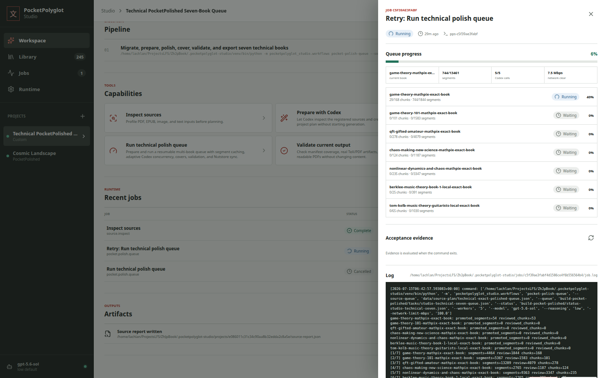
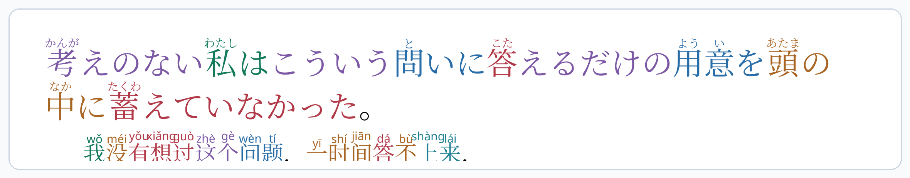
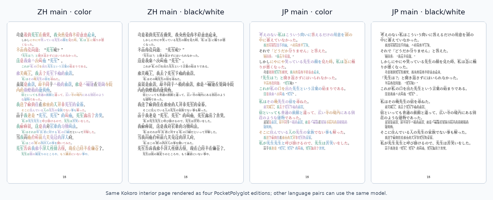

[English](../README.md) · [العربية](README.ar.md) · [Español](README.es.md) · [Français](README.fr.md) · [日本語](README.ja.md) · [한국어](README.ko.md) · [Tiếng Việt](README.vi.md) · [中文 (简体)](README.zh-Hans.md) · [中文（繁體）](README.zh-Hant.md) · [Deutsch](README.de.md) · [Русский](README.ru.md)

[](https://lazying.art)

# PocketPolyglot

أنشئ كتبا interlinear جميلة بحجم الجيب لتعلم اللغات.

PocketPolyglot يحول النصوص الثنائية اللغة إلى ملفات PDF صغيرة تحتوي على ruby وfurigana وpinyin وتلوين نحوي ومحاذاة سطرا بسطر. يركز سير العمل الحالي على الصينية واليابانية، لكن نموذج البيانات يصلح لأزواج أخرى مثل EN-JP وZH-EN والقراءة بين النص الكلاسيكي والحديث.

هذا المستودع هو مجموعة أدوات: قوالب TeX، وسكربتات Python، وعينات JSON، وصور معاينة، وملاحظات pipeline. انشر الكتب الكاملة فقط عندما تكون حقوق النص والترجمة واضحة وقابلة لإعادة التوزيع.

## دعم PocketPolyglot

<!-- support:start -->
[](https://github.com/sponsors/lachlanchen)
[](https://chat.lazying.art/donate)
[](https://paypal.me/RongzhouChen)
[](https://buy.stripe.com/aFadR8gIaflgfQV6T4fw400)
<!-- support:end -->

## PocketPolyglot Studio

يجمع Studio عمليات LinguaLeaf وOCR وتحويل PDF إلى TeX والتحقق والتصدير في تطبيق ويب وواجهة CLI محلية، مع وظائف tmux قابلة للاستئناف وتحقق قائم على الأدلة.

[](../studio/docs/images/pocketpolyglot-studio-queue.png)

## جملة واحدة بعرض كامل

مثال JP-main من Kokoro: نص ياباني مع furigana، وتعليق صيني مع pinyin، وألوان نحوية على الكلمات المتقابلة.

<p align="center">
  <a href="../assets/edition-comparisons/kokoro-jp-main-sentence-page-20.png">
    
  </a>
</p>

## أربع نسخ

الصفحة الداخلية نفسها من Kokoro معروضة في النسخ الأربع القياسية:

<p align="center">
  <a href="../assets/edition-comparisons/kokoro-four-editions-page-20.png">
    
  </a>
</p>

## المخرجات

| النص الرئيسي | ملون | أبيض وأسود |
| --- | --- | --- |
| الصينية كنص رئيسي مع ملاحظات يابانية | تلوين نحوي، pinyin، furigana | مناسب لشاشات e-ink |
| اليابانية كنص رئيسي مع ملاحظات صينية | تلوين نحوي، furigana، pinyin | مناسب لشاشات e-ink |

## الأوامر

```sh
make sample
make interlinear
make interlinear-jp-main
make export-books
make readme-assets
```

الموقع: [learn.lazying.art](https://learn.lazying.art)

## الاستشهاد

إذا استخدمت PocketPolyglot في البحث أو التدريس، فاستشهد بالمستودع. يقرأ GitHub ملف [CITATION.cff](../CITATION.cff) ويعرض خيار **Cite this repository**.

```bibtex
@software{chen_pocketpolyglot_2026,
  author = {Chen, Lachlan},
  title = {PocketPolyglot: Multilingual Interlinear Pocket-Book Studio},
  year = {2026},
  url = {https://github.com/lachlanchen/PocketPolyglot}
}
```
